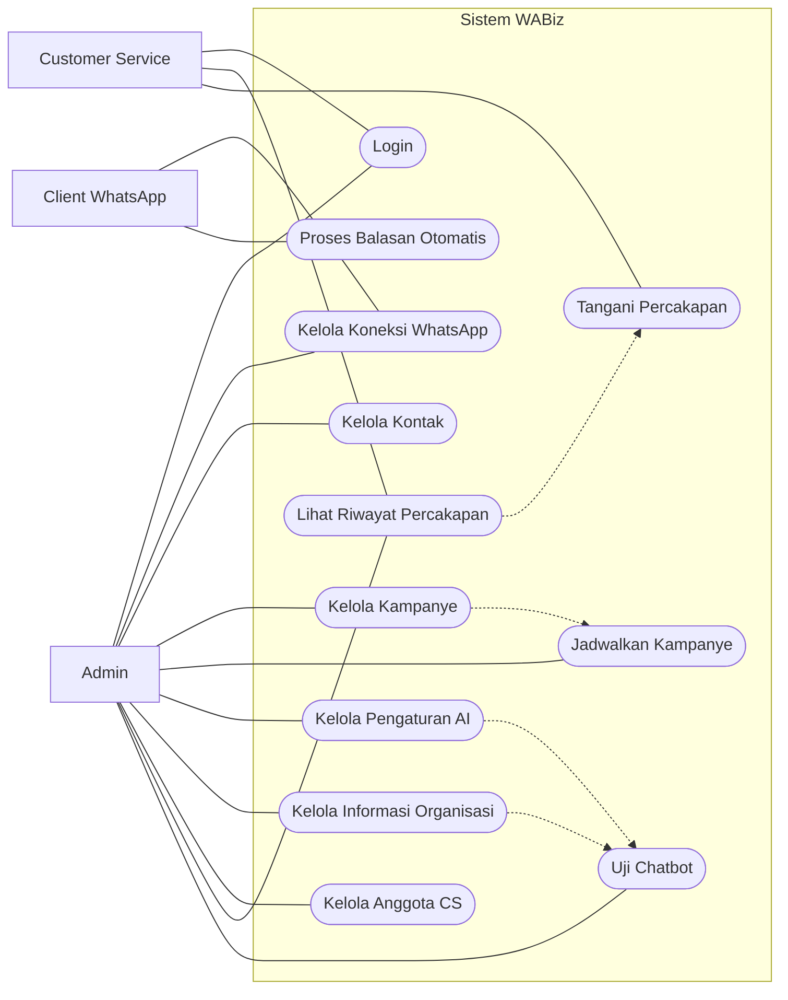
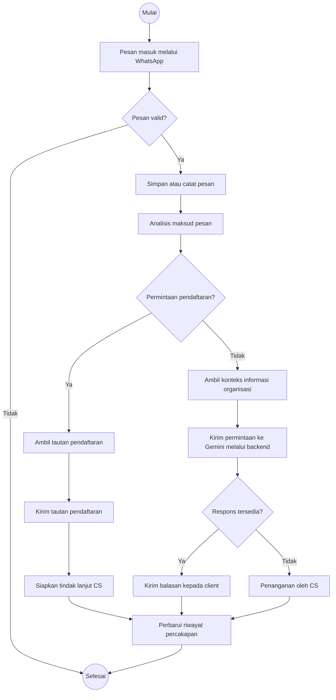
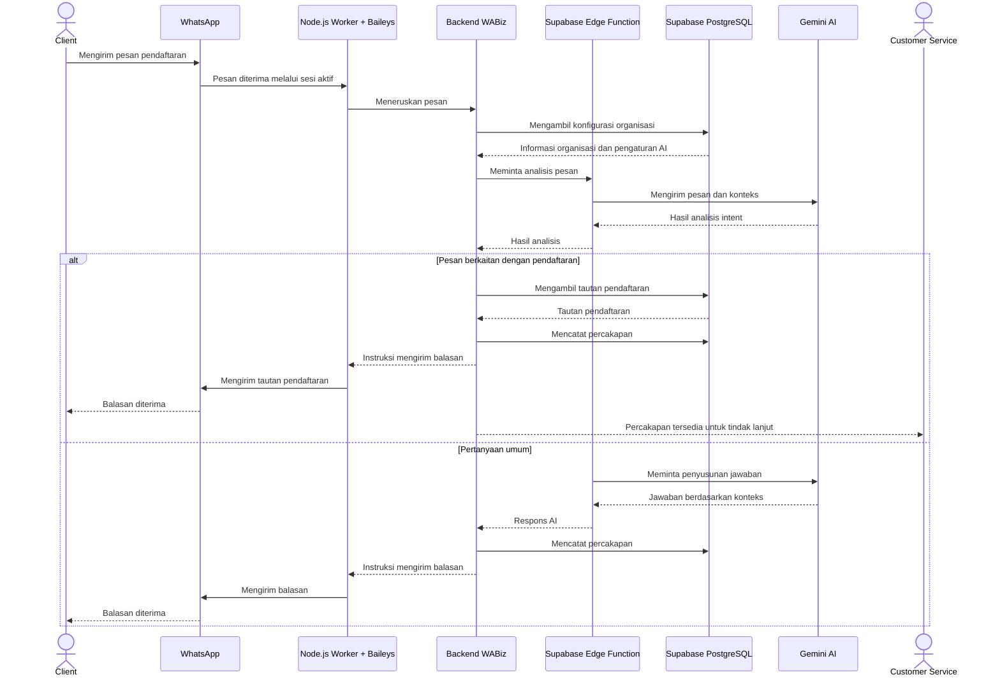
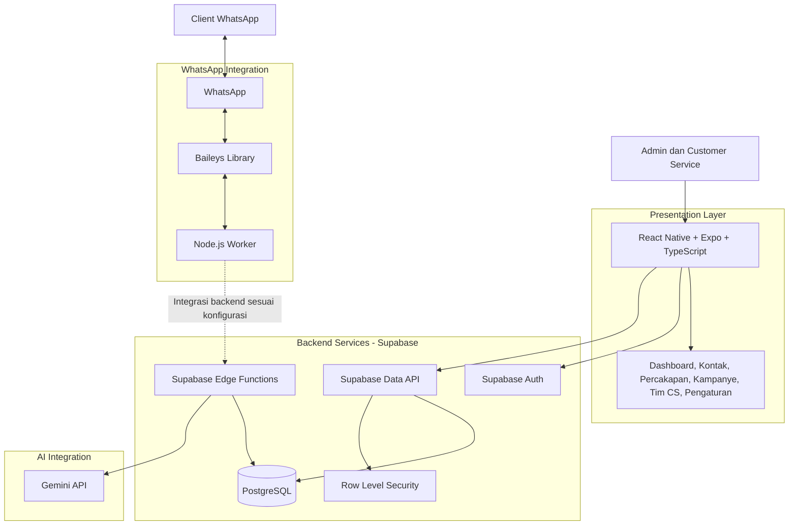

# WABiz — WhatsApp Business Management System

📚 **Tugas Mata Kuliah: Analisis & Pengujian Sistem IF7A**

**Mata Kuliah:** Analisis & Pengujian Sistem  
**Nama Proyek:** WABiz  
**Ketua Kelompok:** Ibnu Ma'ruf - 23EO10024

**Anggota Kelompok:**
- IFROSIM MISBAH - 23EO10036
- Muchammad Rosyidan Khan Ifhamy - 23EO10044

---

# 1. Deskripsi Proyek (20 Poin)

## 1.1 Latar Belakang

WABiz merupakan aplikasi manajemen komunikasi berbasis WhatsApp yang dirancang untuk membantu organisasi dan pelaku usaha mengelola komunikasi dengan pelanggan secara terpusat. Sistem ini ditujukan untuk berbagai jenis organisasi, seperti pondok pesantren, lembaga pendidikan, UMKM, pengelola kos-kosan, yayasan, dan organisasi lainnya.

Dalam kegiatan operasional, organisasi sering menerima banyak pesan yang berkaitan dengan informasi layanan, pendaftaran, pertanyaan pelanggan, dan kebutuhan administrasi. Pengelolaan pesan secara manual dapat menyulitkan pemantauan percakapan, pembagian tugas Customer Service (CS), serta pemberian respons secara konsisten.

Oleh karena itu, WABiz dirancang untuk mengintegrasikan pengelolaan kontak, percakapan, kampanye pesan, anggota CS, informasi organisasi, dan asisten AI dalam satu aplikasi.

Proyek ini dikembangkan sebagai bagian dari tugas mata kuliah **Analisis & Pengujian Sistem**, dengan fokus pada analisis kebutuhan, perancangan sistem menggunakan Unified Modeling Language (UML), implementasi perangkat lunak, serta pengujian fungsional.

## 1.2 Tujuan Proyek

Tujuan pengembangan WABiz adalah:

1. Menganalisis kebutuhan sistem komunikasi WhatsApp untuk organisasi dan bisnis.
2. Merancang sistem menggunakan Use Case Diagram, Activity Diagram, dan Sequence Diagram.
3. Mengembangkan aplikasi mobile dengan antarmuka yang terstruktur dan mudah digunakan.
4. Memusatkan pengelolaan kontak, kampanye, percakapan, dan anggota Customer Service.
5. Menyediakan pengaturan informasi organisasi sebagai sumber konteks untuk asisten AI.
6. Mengintegrasikan layanan backend dan database untuk mendukung penyimpanan serta pengelolaan data.
7. Menyiapkan integrasi WhatsApp untuk menerima pesan dan mengirimkan balasan melalui worker terpisah.
8. Menguji fungsi sistem untuk memastikan kesesuaiannya dengan kebutuhan yang telah ditentukan.

## 1.3 Fitur Utama

- **Dashboard:** Menampilkan ringkasan aktivitas aplikasi.
- **Manajemen Kontak:** Mengelola data kontak, nomor WhatsApp, label, dan catatan.
- **Manajemen Percakapan:** Menyediakan tampilan untuk melihat dan mengelola percakapan.
- **Manajemen Kampanye:** Mengelola rancangan kampanye pesan dan jadwal pengiriman.
- **Chatbot AI:** Mengatur dan menguji asisten AI untuk membantu menjawab pertanyaan.
- **Tim Customer Service:** Mengelola anggota CS dan pembagian tanggung jawab.
- **Pengaturan Organisasi:** Menyimpan informasi identitas, deskripsi, kontak, dan lokasi organisasi.
- **Integrasi Supabase:** Mendukung autentikasi, penyimpanan data, dan logika backend.
- **Integrasi WhatsApp:** Menyiapkan koneksi WhatsApp melalui QR menggunakan Baileys dan Node.js Worker.
- **Integrasi Gemini:** Menyiapkan pemrosesan AI melalui backend atau Supabase Edge Functions.

Status implementasi masing-masing fitur harus mengikuti hasil pengujian aplikasi. Fitur yang masih menggunakan data lokal atau simulasi tidak dianggap sebagai integrasi produksi.

---

# 2. Desain Proyek — Unified Modeling Language (20 Poin)

Perancangan WABiz menggunakan Unified Modeling Language (UML) untuk menggambarkan aktor, fungsi sistem, alur aktivitas, dan urutan interaksi antar komponen.

Diagram UML yang digunakan adalah:

1. Use Case Diagram
2. Activity Diagram
3. Sequence Diagram

## 2.1 Use Case Diagram

Use Case Diagram menggambarkan hubungan antara aktor dengan fungsi-fungsi yang disediakan oleh WABiz.

### Aktor Sistem

- **Admin:** Mengelola pengaturan organisasi, koneksi WhatsApp, kontak, kampanye, chatbot AI, anggota CS, dan riwayat percakapan.
- **Customer Service (CS):** Melihat dan menangani percakapan yang menjadi tanggung jawabnya.
- **Client:** Mengirim pesan dan menerima balasan melalui WhatsApp.
- **Layanan AI:** Menganalisis pesan dan menghasilkan respons berdasarkan konteks yang tersedia. Layanan ini merupakan komponen sistem, bukan pengguna manusia.

### Use Case Diagram WABiz




### Penjelasan Use Case

Admin bertanggung jawab atas pengelolaan konfigurasi dan data utama aplikasi. Customer Service berperan dalam menindaklanjuti percakapan pelanggan. Client berinteraksi dengan organisasi melalui WhatsApp, sedangkan layanan AI membantu proses analisis pesan dan penyusunan respons.

Diagram ini menggambarkan cakupan kebutuhan fungsional. Hak akses aktual harus ditentukan oleh implementasi autentikasi dan kebijakan otorisasi sistem.

## 2.2 Activity Diagram

Activity Diagram menggambarkan alur aktivitas penanganan pesan masuk, mulai dari penerimaan pesan hingga pengiriman respons atau penanganan oleh Customer Service.

### Activity Diagram Penanganan Pesan




### Penjelasan Activity Diagram

1. Sistem menerima pesan dari client melalui koneksi WhatsApp.
2. Pesan divalidasi sebelum diproses.
3. Pesan dicatat untuk mendukung riwayat percakapan.
4. Sistem menganalisis maksud pesan untuk menentukan kebutuhan pengguna.
5. Jika pesan berkaitan dengan pendaftaran, sistem mengambil tautan pendaftaran yang telah dikonfigurasi dan menyiapkan tindak lanjut CS apabila diperlukan.
6. Jika pesan merupakan pertanyaan umum, sistem mengambil konteks informasi organisasi.
7. Backend meneruskan permintaan ke Gemini untuk menghasilkan respons berdasarkan konteks yang relevan.
8. Jika respons tersedia, sistem mengirimkan balasan kepada client.
9. Jika respons tidak tersedia atau memerlukan intervensi manusia, percakapan dapat ditangani oleh CS.
10. Riwayat percakapan diperbarui sesuai mekanisme penyimpanan yang diterapkan.

Alur ini merupakan rancangan proses target. Implementasi setiap tahap perlu diverifikasi melalui pengujian.

## 2.3 Sequence Diagram

Sequence Diagram menggambarkan urutan pertukaran pesan antara client, WhatsApp, Node.js Worker, backend WABiz, Supabase, dan layanan Gemini.

### Sequence Diagram — Penanganan Pesan Pendaftaran




### Penjelasan Sequence Diagram

1. Client mengirim pesan melalui WhatsApp.
2. Node.js Worker menggunakan Baileys untuk menangani pesan melalui sesi WhatsApp yang aktif.
3. Worker meneruskan pesan ke backend WABiz sesuai integrasi yang dikonfigurasi.
4. Backend mengambil informasi organisasi dan pengaturan AI dari Supabase.
5. Backend atau Edge Function mengirimkan pesan beserta konteks yang diperlukan kepada Gemini.
6. Gemini membantu menganalisis maksud pesan dan menghasilkan respons.
7. Jika pesan berkaitan dengan pendaftaran, backend mengambil tautan pendaftaran yang dikonfigurasi.
8. Jika pesan merupakan pertanyaan umum, sistem menyiapkan jawaban berdasarkan konteks organisasi.
9. Sistem mencatat percakapan sesuai implementasi database.
10. Worker mengirimkan balasan melalui WhatsApp.
11. Percakapan dapat ditindaklanjuti oleh CS apabila memerlukan bantuan manusia.

**Catatan:** Diagram sequence menjelaskan rancangan interaksi target. Jalur integrasi worker, Edge Function, Gemini, dan database perlu diuji untuk memastikan seluruh komponen benar-benar terhubung.

---

# 3. Arsitektur Proyek (20 Poin)

WABiz menggunakan arsitektur aplikasi mobile dengan layanan backend terkelola dan worker terpisah untuk integrasi WhatsApp.

Secara umum, arsitektur terdiri atas:

1. **Presentation Layer:** Antarmuka aplikasi mobile.
2. **Backend and Service Layer:** Autentikasi, akses data, dan logika bisnis.
3. **Data Layer:** Database PostgreSQL beserta kebijakan keamanan.
4. **Integration Layer:** WhatsApp Worker dan layanan AI Gemini.

## 3.1 Diagram Arsitektur



## 3.2 Penjelasan Arsitektur

### A. Frontend — React Native, Expo, dan TypeScript

Frontend merupakan bagian aplikasi yang berinteraksi langsung dengan pengguna. React Native digunakan untuk membangun antarmuka mobile, Expo mendukung proses pengembangan dan eksekusi aplikasi, sedangkan TypeScript membantu menjaga konsistensi tipe data pada kode.

Antarmuka WABiz mencakup dashboard, kontak, percakapan, kampanye, chatbot AI, tim CS, dan pengaturan organisasi.

### B. Backend dan Service — Supabase

Supabase menyediakan layanan backend yang mencakup:

- **Supabase Auth:** Mengelola autentikasi pengguna.
- **Supabase Data API:** Menyediakan akses data sesuai konfigurasi dan kebijakan akses.
- **Supabase Edge Functions:** Menjalankan logika backend dan integrasi layanan eksternal yang sesuai.
- **Row Level Security (RLS):** Membatasi akses baris data berdasarkan kebijakan yang telah ditetapkan.

Supabase digunakan agar pengelolaan autentikasi dan data dapat dilakukan tanpa harus membangun seluruh layanan backend dari awal.

### C. Database — PostgreSQL

PostgreSQL digunakan sebagai database relasional melalui Supabase. Database dirancang untuk menyimpan data pengguna, profil organisasi, kontak, kampanye, percakapan, anggota CS, dan konfigurasi AI sesuai skema yang diterapkan.

Struktur tabel, relasi, serta kebijakan RLS perlu diuji untuk memastikan integritas data dan pembatasan akses berjalan dengan benar.

### D. WhatsApp Integration — Node.js Worker dan Baileys

Node.js Worker merupakan proses terpisah yang bertanggung jawab mengelola koneksi WhatsApp dan penanganan pesan. Baileys digunakan sebagai library untuk menghubungkan worker dengan sesi WhatsApp melalui proses pairing QR.

Worker perlu berjalan selama koneksi dan layanan WhatsApp dibutuhkan. Untuk penggunaan produksi, worker memerlukan pengelolaan sesi, penanganan reconnect, logging, monitoring, dan pembatasan akses endpoint.

Baileys merupakan integrasi nonresmi terhadap WhatsApp Web. Penggunaannya memiliki risiko kompatibilitas dan kebijakan layanan, sehingga pilihan integrasi harus dievaluasi sebelum penerapan produksi.

### E. Artificial Intelligence — Gemini

Gemini digunakan untuk membantu analisis pesan dan menghasilkan jawaban berdasarkan konteks informasi organisasi.

Permintaan AI dirancang untuk diproses melalui backend atau Supabase Edge Functions. API key Gemini harus disimpan sebagai secret pada sisi server dan tidak boleh dimasukkan ke kode frontend, aplikasi mobile, atau repositori publik.

Jawaban AI perlu dibatasi oleh konteks yang relevan dan ditangani dengan mekanisme fallback ketika informasi tidak tersedia.

## 3.3 Aspek Keamanan

Aspek keamanan yang menjadi perhatian dalam pengembangan WABiz meliputi:

1. Autentikasi pengguna menggunakan Supabase Auth.
2. Penerapan RLS untuk membatasi akses terhadap data.
3. Validasi input pada proses penambahan dan perubahan data.
4. Penyimpanan secret Gemini di lingkungan backend.
5. Perlindungan sesi WhatsApp dan kredensial worker.
6. Pembatasan akses ke endpoint backend dan worker.
7. Penanganan error tanpa mengekspos informasi rahasia.
8. Pengujian akses lintas organisasi apabila sistem digunakan oleh banyak organisasi.

---

# 4. Tech Stack (20 Poin)

Tech stack adalah kumpulan teknologi yang digunakan untuk membangun, menjalankan, dan mengelola aplikasi WABiz.

| Komponen | Teknologi | Kegunaan |
|---|---|---|
| Frontend | React Native | Membangun antarmuka aplikasi mobile |
| Framework Mobile | Expo | Mendukung pengembangan dan eksekusi aplikasi |
| Bahasa Pemrograman Frontend | TypeScript | Menambahkan pemeriksaan tipe pada kode |
| Backend as a Service | Supabase | Menyediakan layanan backend terkelola |
| Authentication | Supabase Auth | Mengelola autentikasi pengguna |
| Database | PostgreSQL | Menyimpan data aplikasi secara relasional |
| Data Security | Row Level Security (RLS) | Mengatur hak akses terhadap data |
| Serverless Backend | Supabase Edge Functions | Menjalankan logika backend dan integrasi eksternal |
| WhatsApp Library | Baileys | Menangani komunikasi melalui sesi WhatsApp Web |
| Worker Runtime | Node.js | Menjalankan proses WhatsApp secara terpisah |
| Artificial Intelligence | Gemini | Membantu analisis pesan dan penyusunan respons |
| Version Control | Git | Melacak perubahan kode |
| Repository Hosting | GitHub | Menyimpan kode sumber dan dokumentasi |
| Testing | Pengujian fungsional dan integrasi | Memverifikasi kesesuaian sistem dengan kebutuhan |

### Ringkasan Tech Stack

- **FE (Frontend):** React Native + Expo + TypeScript.
- **BE (Backend):** Supabase dan logika server melalui Edge Functions.
- **Database:** PostgreSQL melalui Supabase.
- **Service:** Supabase Auth, Data API, RLS, dan Edge Functions.
- **WhatsApp Integration:** Baileys + Node.js Worker.
- **AI Service:** Gemini melalui backend atau Edge Functions.
- **Repository:** GitHub.

Tech stack tersebut menggambarkan teknologi utama WABiz. Versi paket, konfigurasi, dan status integrasi mengikuti kode aktual dalam repositori.

---

# 5. Pengujian Sistem

Pengujian sistem dilakukan untuk memverifikasi bahwa setiap fungsi berjalan sesuai kebutuhan yang telah ditentukan.

Pengujian mencakup validasi input, pengelolaan data, autentikasi, pemrosesan pesan, integrasi AI, serta komunikasi WhatsApp.

## 5.1 Rencana Pengujian Fungsional

| ID | Fitur | Skenario Pengujian | Hasil yang Diharapkan |
|---|---|---|---|
| TC-01 | Login | Memasukkan kredensial valid | Pengguna berhasil masuk |
| TC-02 | Login | Memasukkan kredensial tidak valid | Sistem menolak autentikasi |
| TC-03 | Kontak | Menambahkan kontak dengan data valid | Kontak tersimpan sesuai implementasi |
| TC-04 | Kontak | Mencari kontak berdasarkan nama atau nomor | Sistem menampilkan hasil yang sesuai |
| TC-05 | Kampanye | Membuat kampanye baru | Kampanye tersimpan sesuai implementasi |
| TC-06 | Tim CS | Menambahkan anggota CS | Anggota muncul pada daftar |
| TC-07 | Pengaturan | Mengubah informasi organisasi | Data diperbarui sesuai mekanisme penyimpanan |
| TC-08 | Chatbot AI | Mengirim pertanyaan untuk diuji | Respons sesuai konfigurasi dan konteks |
| TC-09 | Supabase | Mengakses data menggunakan akun yang sesuai | Data dapat diakses sesuai izin |
| TC-10 | RLS | Mencoba mengakses data tanpa izin | Akses ditolak sesuai kebijakan |
| TC-11 | WhatsApp Worker | Melakukan pairing menggunakan QR | Sesi terhubung apabila pairing berhasil |
| TC-12 | Pesan masuk | Mengirim pesan dari nomor penguji | Worker menerima pesan sesuai implementasi |
| TC-13 | Balasan WhatsApp | Memproses dan mengirim balasan | Pesan balasan terkirim apabila integrasi berhasil |
| TC-14 | Gemini | Mengirim permintaan AI melalui backend | Backend memproses respons tanpa mengekspos secret |
| TC-15 | Penanganan error | Menguji layanan yang tidak tersedia | Sistem menangani kegagalan secara terkendali |

Tabel ini merupakan rencana pengujian. Status setiap skenario harus diisi berdasarkan hasil aktual ketika pengujian dilakukan.

## 5.2 Dokumentasi Hasil Pengujian

Hasil pengujian dapat didokumentasikan menggunakan format berikut:

| ID Pengujian | Hasil Aktual | Status | Bukti |
|---|---|---|---|
| TC-01 | [Isi hasil aktual] | [Berhasil/Gagal/Belum Diuji] | [Tautan screenshot/log] |
| TC-03 | [Isi hasil aktual] | [Berhasil/Gagal/Belum Diuji] | [Tautan screenshot/log] |
| TC-08 | [Isi hasil aktual] | [Berhasil/Gagal/Belum Diuji] | [Tautan screenshot/log] |
| TC-11 | [Isi hasil aktual] | [Berhasil/Gagal/Belum Diuji] | [Tautan screenshot/log] |
| TC-13 | [Isi hasil aktual] | [Berhasil/Gagal/Belum Diuji] | [Tautan screenshot/log] |

Pengujian dianggap berhasil jika hasil aktual memenuhi hasil yang diharapkan. Skenario yang gagal perlu dianalisis dan diperbaiki sebelum dinyatakan selesai.

---

# 6. Instalasi dan Menjalankan Proyek

## 6.1 Prasyarat

Perangkat pengembangan membutuhkan:

- Node.js dan npm.
- Git.
- Proyek Supabase.
- Perangkat Android, emulator, atau lingkungan yang mendukung Expo.
- Konfigurasi environment untuk layanan yang digunakan.
- Akses Gemini API apabila fitur AI diaktifkan.

## 6.2 Clone Repository

```bash
git clone <URL_REPOSITORY_GITHUB>
cd wa-biz
npm install
```

Ganti `<URL_REPOSITORY_GITHUB>` dengan URL repositori yang sebenarnya.

## 6.3 Konfigurasi Environment

Buat file `.env` berdasarkan `.env.example` dan isi konfigurasi yang diperlukan.

Variabel frontend yang digunakan untuk konfigurasi Supabase harus mengikuti nama yang dipakai dalam kode, misalnya:

```env
EXPO_PUBLIC_SUPABASE_URL=<URL_PROYEK_SUPABASE>
EXPO_PUBLIC_SUPABASE_PUBLISHABLE_KEY=<SUPABASE_PUBLISHABLE_KEY>
```

Nama variabel di atas harus dicocokkan dengan konfigurasi aktual aplikasi.

Jangan menyimpan service role key atau secret Gemini pada variabel frontend `EXPO_PUBLIC_*`, karena variabel dengan awalan tersebut dapat dimasukkan ke bundle aplikasi.

Simpan secret Gemini dan kredensial sensitif lainnya di secret management backend, misalnya Supabase Edge Function Secrets atau environment worker yang terlindungi.

Jangan mengunggah file `.env` berisi kredensial ke GitHub.

## 6.4 Menjalankan Frontend

```bash
npx expo start
```

Untuk menjalankan versi web apabila dependensi web telah dikonfigurasi:

```bash
npx expo start --web
```

## 6.5 Menjalankan WhatsApp Worker

WhatsApp Worker berjalan sebagai proses terpisah dari frontend. Masuk ke direktori worker yang sesuai dengan struktur repositori, kemudian jalankan script yang tersedia pada `package.json` worker.

Contoh apabila script `start` telah disediakan:

```bash
npm start
```

Worker perlu tetap aktif selama sesi WhatsApp digunakan. Konfigurasi port, endpoint health check, dan environment harus mengikuti implementasi aktual.

---

# 7. Repository GitHub dan Demonstrasi UTS (20 Poin)

**Repository GitHub:** [Masukkan URL Repository WABiz]

Repositori ini digunakan untuk menyimpan kode sumber, dokumentasi, diagram UML, konfigurasi nonrahasia, dan bukti pengujian proyek.

## 7.1 Rencana Demonstrasi

Demonstrasi proyek pada UTS direncanakan mencakup:

1. Menjelaskan latar belakang, tujuan, dan ruang lingkup WABiz.
2. Menjelaskan Use Case Diagram, Activity Diagram, dan Sequence Diagram.
3. Menjelaskan arsitektur aplikasi dan fungsi setiap komponen.
4. Menunjukkan antarmuka dashboard, kontak, kampanye, percakapan, dan tim CS.
5. Menunjukkan pengaturan informasi organisasi dan konfigurasi chatbot AI.
6. Mendemonstrasikan autentikasi serta penyimpanan data apabila integrasi telah siap.
7. Menunjukkan koneksi WhatsApp melalui QR apabila worker berhasil dijalankan.
8. Mendemonstrasikan pemrosesan pesan dan respons Gemini apabila integrasi telah berfungsi.
9. Menampilkan hasil pengujian fungsional dan menjelaskan kendala yang ditemukan.
10. Menjelaskan batasan implementasi dan rencana pengembangan berikutnya.

## 7.2 Artefak Proyek

Contoh struktur dokumentasi yang diharapkan:

```text
wa-biz/
├── App.tsx
├── package.json
├── .env.example
├── docs/
│   └── images/
│       ├── use-case.png
│       ├── activity.png
│       └── sequence.png
├── src/
│   └── ...
└── server/
    └── ...
```

Struktur tersebut merupakan gambaran umum. Nama folder dan file harus disesuaikan dengan struktur aktual repositori WABiz.

---

# 8. Kesimpulan

WABiz merupakan aplikasi manajemen komunikasi WhatsApp yang dirancang untuk membantu organisasi dan bisnis mengelola kontak, percakapan, kampanye pesan, anggota Customer Service, informasi organisasi, dan layanan asisten AI.

Proyek ini menerapkan React Native, Expo, dan TypeScript untuk pengembangan aplikasi mobile; Supabase untuk autentikasi dan penyimpanan data; Node.js Worker dan Baileys untuk integrasi WhatsApp; serta Gemini untuk mendukung pemrosesan AI melalui backend.

Melalui analisis kebutuhan, perancangan UML, dokumentasi arsitektur, implementasi, dan pengujian fungsional, WABiz dikembangkan sebagai penerapan konsep Analisis & Pengujian Sistem.

Dokumentasi ini membedakan rancangan, implementasi, dan hasil pengujian agar status sistem dapat dievaluasi secara objektif pada saat demonstrasi UTS.
